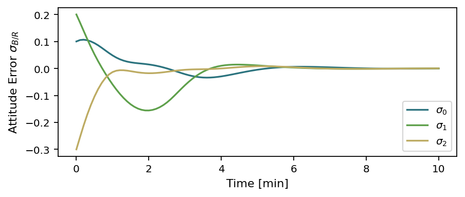
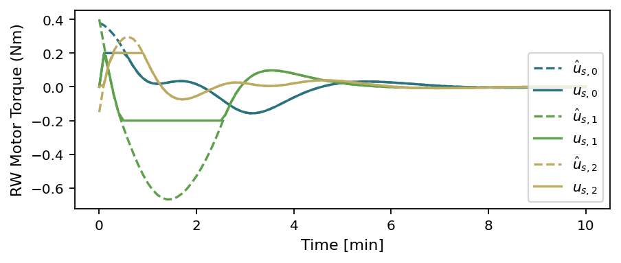
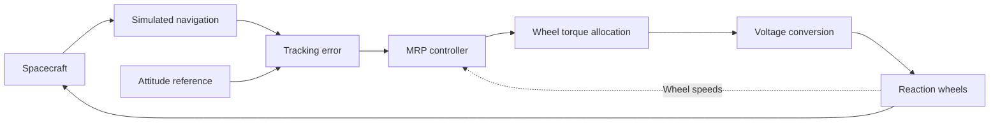

# AttitudeGuard

Spacecraft attitude control and fault-recovery experiments built on [Basilisk](https://github.com/AVSLab/basilisk).

**Current milestone:** C++–Python interoperability verified, including actual Basilisk callbacks. Next: configure the synthetic spacecraft in SC-04.

## Sprint progress

| Sprint | Goal | Status |
| :--- | :--- | :--- |
| 1 | Verify the environment and working example | Complete |
| 2 | Preserve the baseline, figures, and control path | Complete |
| 3 · SC-03 | Verify C++20 interface and Basilisk callbacks | Complete |
| 4 · SC-04 | Configure the synthetic spacecraft and smoke run | Not started |

## Run the baseline

Use the existing environment on this machine:

```sh
cd ~/AttitudeGuard
source .venv/bin/activate
python sim/baseline/scenarioAttitudeFeedbackRW.py
```

To rerun both copies and refresh the saved figures and logs:

```sh
python docs/verify_baseline.py
```

**Configuration:** 10 minutes · 0.1-second step · voltage interface on · wheel jitter off.

## C++–Python interface

Build and test with the existing environment active:

```sh
clang++ -std=c++20 -dynamiclib cpp/probe.cpp -o cpp/libprobe.dylib
python tests/check_probe.py
python sim/check_probe_callback.py
```

**Verified:** scalar calls, record copying, matching memory layout, both null-pointer cases, and repeated inputs. Basilisk invokes six callbacks from 0.0–0.5 seconds at a **0.1-second period**.

The callback check uses a dedicated flight-software task and synthetic gyro data; spacecraft configuration is the next sprint.

[Interface documentation](docs/interop.md) · [Full test results](results/interop-checks.txt)

## Baseline results

| Attitude tracking error | Reaction-wheel torque |
| :---: | :---: |
|  |  |

[All figures and run logs](results/baseline/) · [Configuration and control path](docs/baseline.md)

## Control loop



## Repository guide

| Folder | Contents |
| :--- | :--- |
| `docs/` | Baseline and interface notes, environment record, and verification script |
| `cpp/` | C++20 probe source and compiled shared library |
| `tests/` | Standalone Python interface checks |
| `sim/` | Probe adapter and Basilisk callback test |
| `sim/baseline/` | Preserved working simulation |
| `results/baseline/` | Verified figures and execution logs |
| `results/interop-checks.txt` | SC-03 build and test evidence |
| `examples/` | Original Basilisk examples and supporting assets |

Environment: **macOS arm64 · Python 3.14.4 · Basilisk 2.12.0**. See the [environment record](docs/environment.txt) and [dependency snapshot](docs/requirements-baseline.txt).

The verified baseline demonstrates the upstream simulation. It does not yet demonstrate AttitudeGuard's original controller or fault recovery. Fresh-machine setup remains unverified.

Basilisk example code is credited to the Autonomous Vehicle Systems Lab, University of Colorado at Boulder. Its ISC notices remain in the source files.
